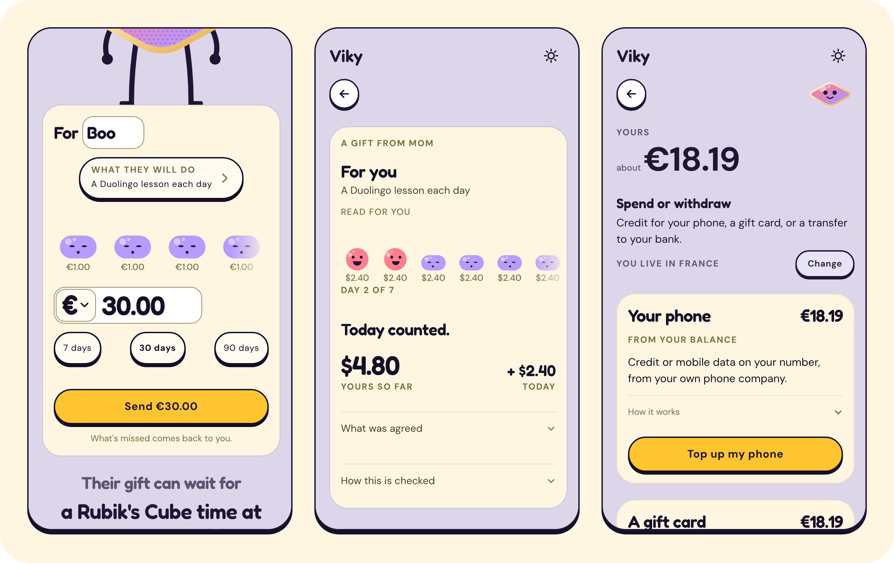
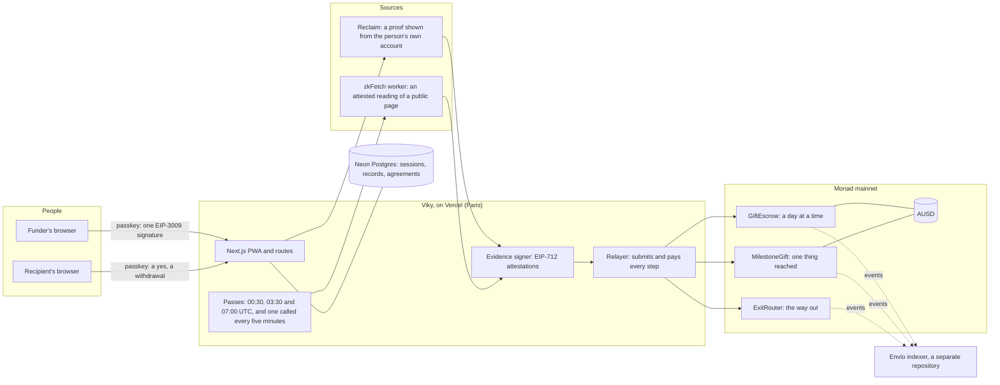

# Viky

**Send money that motivates.**

The money is already in their name. Every day they miss, a piece comes back to you.

Viky is a conditional payment on Monad. Someone puts money behind another person's goal. The money is
allocated in the recipient's name from day one, becomes theirs as verified progress accrues, and
returns to the funder for whatever is not accomplished. Nobody ever profits from a missed day.

**[The app](https://viky.cash)** · **3-minute video** (its link comes with the submission) · **[The judges page](https://viky.cash/judges)**

Built for Monad Metropolis, track Consumer Products & Payments.



Three of the app's own screens, photographed by the test suite with example data: the card a gift is filled in on, a
gift's page with its days, and "Spend or withdraw".

| On Monad mainnet (chain 143) | Where | Verified by |
|---|---|---|
| `GiftEscrowV3`: a gift for a habit, a day at a time | [`0x591d76863177E70FfcA2C793212d4715A367Ec70`](https://monadvision.com/address/0x591d76863177E70FfcA2C793212d4715A367Ec70) | its source, an [exact match](https://sourcify-api-monad.blockvision.org/v2/contract/143/0x591d76863177E70FfcA2C793212d4715A367Ec70) |
| `MilestoneGiftV2`: a gift for one thing reached, with a deadline | [`0x493c87A27E637bBc7179C17bE2B215fC18523CC0`](https://monadvision.com/address/0x493c87A27E637bBc7179C17bE2B215fC18523CC0) | its source, an [exact match](https://sourcify-api-monad.blockvision.org/v2/contract/143/0x493c87A27E637bBc7179C17bE2B215fC18523CC0) |
| `ExitRouter`: the way out of what a gift earned | [`0x8a1790DfD10CF1599bDaeD5eC8BB46B2A6eB6223`](https://monadvision.com/address/0x8a1790DfD10CF1599bDaeD5eC8BB46B2A6eB6223) | its source, an [exact match](https://sourcify-api-monad.blockvision.org/v2/contract/143/0x8a1790DfD10CF1599bDaeD5eC8BB46B2A6eB6223) |
| `ExitRouter`, a second copy set on USDC: the converter of card payments | [`0xf05449c8b868Ce1e6a0D7223e2ceCbbfD1498F9c`](https://monadvision.com/address/0xf05449c8b868Ce1e6a0D7223e2ceCbbfD1498F9c) | its source, an [exact match](https://sourcify-api-monad.blockvision.org/v2/contract/143/0xf05449c8b868Ce1e6a0D7223e2ceCbbfD1498F9c) |
| Their owner: a Safe 1.4.1 that signs with 2 of its 3 keys | [`0xE08D926c148A5065F4Df2892702785a183de86F9`](https://monadvision.com/address/0xE08D926c148A5065F4Df2892702785a183de86F9) | `owner()` on each contract |
| **A credited day, checked again from nothing** | `pnpm verify:day`, below | five answers, each `yes`, for transaction [`0x55f9…6fab`](https://monadvision.com/tx/0x55f9eafa857ee9897be5a7e092e055a3c75d2003d11a087dd9a0244e64726fab) |
| **A refusal**: an account that is not the recipient asks for what a gift earned | `cast call`, below | the error `NotRecipient()`, `0x586d3357` |

```bash
# A credited day: no key, no account, no variable.
git clone https://github.com/RedGnad/Viky.git && cd Viky && pnpm install && pnpm verify:day

# A refusal, on the contract in service, with Foundry's cast: it answers "execution reverted", data 0x586d3357,
# which is NotRecipient().
cast call 0x591d76863177E70FfcA2C793212d4715A367Ec70 "withdrawEarned(uint256,address,uint256)" \
  1000 0x000000000000000000000000000000000000dEaD 1 --rpc-url https://rpc.monad.xyz
```

`pnpm verify:day` proves that the source's own servers answered and that the contract settled that day against that
one claim, which can never be used again. It does not prove whose account it is, nor that a human did the work:
[what it checks, and its limits](docs/VERIFICATION.md#check-a-credited-day-yourself). The sources are verified on
MonadVision, the explorer, through its Sourcify instance. The nine deployments, the earlier versions that still run
the gifts they hold among them, are in [Contracts](docs/CONTRACTS.md).

[](https://github.com/RedGnad/Viky/actions/workflows/ci.yml?query=branch%3Amain)
the last run of the checks on `main`: types, lint, the policy tests, the contracts' tests and the screens in a browser.

## What Viky is built on

| | What it does in Viky | Where to look |
|---|---|---|
| **Monad** | Every gift is made, credited and closed on mainnet. A step is final one or two blocks after its own, at a block every 0.302 s. A credited day costs 0.017544 MON, about $0.0006, and Viky's relayer pays it. | [Why Monad](#why-monad), below |
| **AUSD, Agora's dollar** | The only currency a gift holds. One EIP-3009 signature funds a gift, and a plain send between two accounts is one relayed transaction. On 8 Oct 2026, on Monad testnet, the way out sent 10.00 test AUSD through Agora's Instant Settlement pair and got 10.00 of the pair's other test coin back, one for one, on one signature. | `pnpm agora:testnet check`, transaction [`0x854e…b95c`](https://testnet.monadscan.com/tx/0x854e8518cc0c1be79a90500c7f2129deec0232bd8ee1f2d8edbf14c70453b95c), the [judges page](https://viky.cash/judges), "AUSD, Agora's dollar" |
| **Mera** | The whole account layer: an account is a passkey and nothing else. Two gestures take a person from a gift's link to their first transaction. One prompt yields two keys: the account's, and an Ed25519 key that signs the recipient's yes and their stop and can move no money. | `src/account/mera.ts`, `src/client/consent-key.ts`, `pnpm verify:consent` |
| **Envio HyperIndex** | The events of the gift contracts, the way out and the anchor of agreements are indexed. The judges page reads the index each time it is served, and sets it beside AUSD's own `balanceOf`, contract by contract. | [`RedGnad/Viky-index`](https://github.com/RedGnad/Viky-index), the [judges page](https://viky.cash/judges), "The index of the contracts' events" |
| **Alchemy** | On viky.cash, every read a browser makes of Monad goes through Alchemy's Monad RPC first, with Monad's public endpoint behind it. | `monadTransport`, `src/monad/chain.ts`; the [judges page](https://viky.cash/judges) names it under "Network", from the deployment's own setting |
| **Reclaim** | The attested reading of a source, and the proof a person shows from their own account, in a tab where they sign in themselves. | [Verification](docs/VERIFICATION.md) |

## Who it is for, and the problem

Viky is for the person who pays for somebody else's effort from a distance and cannot check it themselves: a
parent paying for a year of studies in another city or another country, a relative backing a language, a
certificate, a race. Today they send the money and hope, or they hold it back and ask for proof in a message.
Either way the money and the proof travel apart, and the one who pays is the one who has to ask.

With Viky the money is put in the other person's name on the first day. A source that is not Viky says whether
the thing was done: the lesson, the rating, the certificate, the enrolment. Each verified part becomes theirs,
and whatever is not earned comes back to the funder by itself. Nobody profits from a missed day: not Viky, not a
pool, not another user.

Money earned leaves the way the person's country allows: to a bank account, to a card, to a mobile money number, as
phone credit, as a gift card, or on to another Viky account.

## What we know about the two people

The one who pays funds another person's studies or training from a distance; the one who is read asked for nothing.
So the whole amount is in their name from the first minute, the funder sees yes or no for a day or the number a goal
has and nothing else that was read, and the recipient agrees with a signature of their own and can stop being read.

[The studies behind each screen, and the four things that changed when people used it](docs/THE-TWO-PEOPLE.md).

## What is new

Tools for keeping a commitment already exist (Beeminder, StickK, Forfeit): there, a person stakes their own
money and loses it to somebody else. What Viky does differently is the third-party funder, the money allocated in
the recipient's name, the release on a verified reading, and the automatic return of the rest.

## No word of crypto

Neither person meets a word of crypto in Viky: no wallet, no seed phrase, no network fee, no coin to hold. A coin is
named in one place, a payment service's own page, which Viky opens already filled in where the service allows. Where
it does not, Viky says what to pick there in the service's own two words, quoted as its page prints them. A check
looks for seven such words at every change (wallet, gas, chain, seed, token, transaction hash, address:
`pnpm check:words`, `src/consumer-words.ts`): in the source of the screens, in the sentences they print, in the
routes that answer them (its list of files is `scripts/check-consumer-words.ts`) and in what a browser renders
(`test/browser/screens.spec.ts`).

## Eighteen conditions

**3 paid with real money, 10 read on their real page, 4 open and waiting for their first person, 1 on request.**
A condition is proven the day the thing happens: a lesson is daily, a race has a date, a university gives its results
once a year.

| Family | Condition | How it is read | Where it stands, 12 Oct 2026 |
|---|---|---|---|
| **Learn** | A Duolingo lesson each day | Read for you | **Paid with real money** |
|  | Reach a Codeforces rating | Read for you | Read on its real page |
|  | A certification on Credly | Read for you | Read on its real page |
|  | A credential on Accredible | Read for you | Read on its real page |
| **School & studies** | Enrolled at university | Shown by them | **Paid with real money** |
|  | Passed the year at university | Shown by them | Open. Waits for the year's results. |
|  | Reached a grade at university | Shown by them | Open. Waits for the year's results. |
|  | A TOEFL score | Shown by them | Open. Nobody has shown one yet. |
|  | A Duolingo English Test score | Read for you | Read on its real page |
|  | An edX certificate | Read for you | Read on its real page |
|  | An MIT course certificate | Read for you | Read on its real page |
|  | A Coursera certificate | Read for you | Read on its real page |
| **Play** | A chess rating on Chess.com | Read for you | **Paid with real money** |
|  | A puzzle record on Chess.com | Read for you | Read on its real page |
|  | A cube result in competition | Read for you | Read on its real page |
| **Move** | Active minutes a day, Fitbit | Connected by them | Open. Takes a Fitbit tracker or a Pixel Watch. |
|  | Kilometres a day, on Strava | Connected by them | On request. Ready two days after a first gift. |
|  | Finish a race | Read for you | Read on its real page |

Strava opens on request, within two days of a first gift: its developer program is a paid subscription, taken when a
gift asks for it, and serves ten athletes before its review, up to 9,999 after it.

At a university, any of 11,000 (the first is read today; each other is set up within two days of a first gift).

Live counts and what each one proves: [the judges page](https://viky.cash/judges).

## Why Monad

Only what was measured, or what Monad's own documentation states.

- **Nobody but Viky pays a fee, and it is small enough to be Viky's.** Every step of a gift is submitted and paid for
  by one relayer, so neither person ever holds MON or reads a fee. Read from the chain on 2 Oct 2026 at 12:11 UTC
  with `pnpm relayer:fees`: 120 transactions sent since the first one, 2.196190 MON of fees in all, 0.0183 MON a
  transaction on average. A credited day costs 0.017544 MON (transaction
  `0x55f9eafa857ee9897be5a7e092e055a3c75d2003d11a087dd9a0244e64726fab`: a limit of 172,000 at 102 gwei).
- **A person waits about a second.** A block every 302 ms, measured over 10,000 blocks on 2 Oct 2026, and a
  block is final after two ([docs](https://docs.monad.xyz/developer-essentials/summary)). Nothing is shown as done
  before the block that holds it is at or below the `finalized` tag (`waitForFinality`, `src/monad/chain.ts`).
- **One signature funds a gift.** AUSD is on Monad with EIP-3009: the funder signs once, and that signature is both
  the payment and the acceptance of the gift's exact terms, because the authorization's nonce is the hash of the terms.
  The relayer submits it; `receiveWithAuthorization` can only land in the contract.
- **Monad's own rules, followed.** The fee is the declared limit times the price, not the gas used
  ([docs](https://docs.monad.xyz/developer-essentials/gas-pricing)), so every relayed step is estimated and given a
  margin of 7.5 % and no more (`src/monad-gas.ts`). The chain reserves 10 MON per account
  ([docs](https://docs.monad.xyz/developer-essentials/reserve-balance)), so the relayer refuses to send below 12 MON
  (`src/relayer.ts`).

## What has run with real money

Only what has a transaction on Monad mainnet. How many people have used Viky is counted on the judges page, from the
index, and the testers' figures come with the submission.

| What happened | Date | Amount | Transaction |
|---|---|---|---|
| **A gift between two people who are not the author**, paid on the proof a student showed from their university's portal, at Toulouse. It was that university's first proof: held, then paid once the operator had read what it had read. | 7 Oct 2026 | 8.98 AUSD | [`0x9c55…c4fd`](https://monadvision.com/tx/0x9c5508e83b0dd20668bb6a8c683faa047820734d6938387f8b6f516c3467c4fd) |
| **The same student's next gift, paid 20 seconds after they signed in** to that portal, on the rule fixed ahead of the pass, with no review. | 9 Oct 2026 | 5.02 AUSD | [`0xd950…77e2`](https://monadvision.com/tx/0xd950295c4c3d51480496003fd6547b0fc6c3546ac0c5747d377e6259cd3277e2) |
| **A daily gift from its funding to its end, on the contract in service**, made by the author between two of his own accounts: one day credited, 0.187 AUSD, and the 29 others, 5.423 AUSD, back to the funder. | 3 and 4 Oct 2026 | 5.61 AUSD | [`0xa6db…de72`](https://monadvision.com/tx/0xa6db35d9f3716d238c7f55770a8853612fab90a19e059c14706959f0dbafde72) |
| **A card payment converted**: the USDC a card service delivered to the funder's own account, changed into AUSD on one signature. | 3 Oct 2026 | 7.914524 AUSD | [`0x533e…1616`](https://monadvision.com/tx/0x533ec0746493e0670029b917887b8e15376380a4a9c7bb82706b2de910ed1616) |
| **A day credited on a proof**: the day the command of the first screen checks again. | 12 Sep 2026 | 0.142857 AUSD, one day of a 1.00 AUSD gift | [`0x55f9…6fab`](https://monadvision.com/tx/0x55f9eafa857ee9897be5a7e092e055a3c75d2003d11a087dd9a0244e64726fab) |

What has not run on the third daily contract yet: a missed day going back, and a gift reaching its last day.

<details>
<summary><b>Each of them step by step, with its transactions</b></summary>

- **A day credited on a proof.** Gift 2, the day of 12 Sep 2026, on `GiftEscrow` at `0x995A…e233`, the deployment that
  followed the first: [`0x55f9…6fab`](https://monadvision.com/tx/0x55f9eafa857ee9897be5a7e092e055a3c75d2003d11a087dd9a0244e64726fab). It is the day
  `pnpm verify:day` checks again.
- **A daily gift from its funding to its end, on the contract in service.** Gift 1000 on `GiftEscrowV3`, made by the
  author between two of his own accounts. All times are UTC.
  1. 3 Oct 2026, 21:44: created and funded with 5.61 AUSD for 30 days, in one transaction ([`0xa6db…de72`](https://monadvision.com/tx/0xa6db35d9f3716d238c7f55770a8853612fab90a19e059c14706959f0dbafde72)).
  2. 21:45: opened from the recipient's account ([`0x4616…83a0`](https://monadvision.com/tx/0x461606cd6712f19246f4071768c464a30e5f23a1c9b9ecb906abc696716e83a0)).
  3. 4 Oct, 00:02: the account it is read from bound to the gift, and a first reading recorded, with no day
     credited ([`0x3d31…faf7`](https://monadvision.com/tx/0x3d31ec549118f2a01c8d2791939a711b0f1ab4c4afcf1e65528e70f7d55efaf7)).
  4. 03:23: one day credited, the day its lesson was read ([`0xc7b0…2e02`](https://monadvision.com/tx/0xc7b0d0ab48eff37636570dccd87636306b40be8214597ae8652e2d0b7d3e2e02)).
  5. 03:44: ended from the recipient's account, and the 29 days neither counted nor missed, 5.423 AUSD, back to the
     funder in the same transaction ([`0x3881…0bc2`](https://monadvision.com/tx/0x3881bf6675a6b428f6c96a0845a2b8547504033f87db303908986189bc170bc2)).
  6. 03:44: the 0.187 AUSD it earned withdrawn ([`0xf2d4…cf10`](https://monadvision.com/tx/0xf2d4cdb9393dc0e4507a6f282991edccdf93ecd60e18323cd33e1e5f8b59cf10)). The contract holds nothing of it.
- **A card payment converted.** 3 Oct 2026: the USDC a card service delivered to the funder's own account, changed
  into 7.914524 AUSD on one signature ([`0x533e…1616`](https://monadvision.com/tx/0x533ec0746493e0670029b917887b8e15376380a4a9c7bb82706b2de910ed1616)).
- **Toulouse, 9 Oct 2026: a student showed their enrolment, and the gift paid 20 seconds after they signed in to
  their university's portal, with no review.**
  Gift 1000008 on the second `MilestoneGift`, 5.02 AUSD for staying enrolled, made out to the same account as the
  gift below. The verification opened at 12:54:27 UTC, on the rule fixed ahead of the pass, the portal's sign-in form
  was gone from the page at 12:55:09, and the gift paid in the block of 12:55:27
  ([`0xd950…77e2`](https://monadvision.com/tx/0xd950295c4c3d51480496003fd6547b0fc6c3546ac0c5747d377e6259cd3277e2)).
  Nobody read the proof first: it fitted the rule, so it was paid at once.
- **The first pass, two days before: a gift between two people who are not the author, paid on a proof from a
  university's portal.** Gift 1000006 on
  the second `MilestoneGift`, 8.98 AUSD for staying enrolled. All times are UTC.
  1. 5 Oct 2026, 12:19: created and funded by a third party, in a student's name ([`0x7ab3…0690`](https://monadvision.com/tx/0x7ab335573f852af027c034f181c5788f4d38f0c1bc4a4937ef0dc28f787a0690)).
  2. 7 Oct, 12:15: opened by the student ([`0xdf97…a950`](https://monadvision.com/tx/0xdf971f921f2533b984c434d2010e73a08e2012e43532ebc95d54843053c3a950)).
  3. 15:36: paid, 8.98 of 8.98 AUSD his, on the proof he showed at 14:58 from his own student file on the Université
     de Toulouse's portal. It was the first proof from that university, so it was held, and nothing moved until the
     operator had read what it had read ([`0x9c55…c4fd`](https://monadvision.com/tx/0x9c5508e83b0dd20668bb6a8c683faa047820734d6938387f8b6f516c3467c4fd)).

  What that proof read is narrow, and is said as it is: signed in to his own file, the answer to one click carried the
  academic year 2026-2027. The rule was written by Reclaim's agent during his pass: it names no person, no number and
  no faculty, and it was pinned on 7 Oct 2026; since 9 Oct the rule in force is one fixed ahead, which the judges page
  prints.

</details>

[viky.cash/judges](https://viky.cash/judges) is the one page for verifying Viky: the contract addresses on Monad
mainnet, who owns them (read from the chain when the page is served), every condition a gift can wait for and the
source it is read from, the commands to re-verify a credited day yourself, and the risks and limits, written as they
are. It also says how to try the product with your own passkey.

## Path forward: how the next hundred find Viky

The funder is the unit: one funder pays, and their gift opens an account in the name of someone who asked for nothing.
The next hundred come through a person who already has a role, where the gesture already exists: a student
association's treasurer, a club officer, a member of a community that already keeps commitments.

[The three channels, their first targets, and what would stop the plan](docs/PATH-FORWARD.md).

## Architecture



A person's passkey derives their account in the browser; no key ever reaches a server. The funder's one signature
funds a gift. From then on Viky reads the source, the evidence signer attests what was read, the relayer submits it,
and the contract moves the money: to the recipient for what is verified, back to the funder for what is not.

In detail: [Contracts](docs/CONTRACTS.md), [Verification path](docs/VERIFICATION.md),
[Pages and routes](docs/PAGES-AND-ROUTES.md), [Indexer](docs/INDEXER.md).

## Stack

- PWA: Next.js 16 with Serwist (offline fallback, web push), Turbopack build.
- Accounts: Mera passkeys only. A passkey's PRF output derives an ordinary Monad account
  (BIP-44 `m/44'/60'/0'/0/0`). No seed phrase, no extension, no custody backend.
- One passkey, two keys. The same ceremony that signs a person in evaluates a second salt,
  `sha256("viky:consent:v1")`, and its output is an Ed25519 key held in the browser's memory
  (`src/client/consent-key.ts`). It signs the recipient's yes and their stop, and nothing else: it is not the account's
  key and can move no money, so the agreement to be read is given with the least privilege it needs. The server keeps
  the text that was signed, the signature and the key's public half, with the gift, and checks them again at every
  reading that could move money (`src/consent-guard.ts`): no yes, or a stop, and nothing is read.
- Asset: AUSD on Monad mainnet.
- Contracts: Foundry 1.8.1 with `network = "monad"`.
- Tests: `node:test` through `tsx` for TypeScript, `forge test --network monad` for Solidity, Playwright for the
  screens.

## Run

Node 24 (`.nvmrc`) and pnpm 10 (`corepack enable` gives the version `package.json` names).

```bash
git clone https://github.com/RedGnad/Viky.git
cd Viky
pnpm install
cp .env.example .env.local
```

In `.env.local`, give `SESSION_SIGNING_SECRET` any random string of 32 characters or more (`openssl rand -hex 32`
prints one). Then:

```bash
pnpm dev
```

and open `http://localhost:3000`. Followed on a fresh clone on 5 Oct 2026, with that one variable: every page answers,
from the landing and its card to the judges page, and `/api/health` answers 503 and names what is not configured yet.

Each further step is one group of variables in `.env.example`, in the order they are needed: a Neon Postgres
database (`DATABASE_URL`, then `pnpm db:migrate`, which creates the tables and can be run again) for accounts; the
relayer, the evidence signer and the contracts' addresses for money on mainnet; the Reclaim applications and the
reading worker for readings. [Environment](docs/DECLARATIONS.md#environment) says what each group opens.

Passkeys need HTTPS or `localhost`. The relying party id is the hostname the app is served from,
so accounts created on a preview hostname stay on that hostname.

### Deploy

- **The app** is deployed on Vercel from `main`. `vercel.json` sets the region (Paris) and the four daily passes; the
  variables are those of `.env.example`.
- **The database** is Postgres on Neon, reached through Neon's own driver: `pnpm db:migrate` creates the tables.
- **The reading worker** is built from `Dockerfile` and runs `pnpm zkfetch:worker`. The app reaches it through
  `ZKFETCH_WORKER_URL` and `ZKFETCH_WORKER_SECRET`.
- **The contracts** are built with Foundry and deployed to Monad mainnet by `pnpm deploy:v2` (the second version of
  the gift contracts and the anchor of agreements), `pnpm deploy:v3` (the third version of the daily contract),
  `pnpm deploy:exit-router` and `pnpm deploy:usdc-router`. The two gift deployments hand their contracts to the
  owner, who accepts them; `pnpm check:v2-handover` and `pnpm check:v3-handover` read a deployment back before its
  address is set in the app, and `pnpm check:signer` holds the evidence key of the environment against the signer
  the contracts name.
- **The index** is its own repository: [Indexer](docs/INDEXER.md).

## Test

```bash
pnpm test:policy
pnpm test:solidity
pnpm test:browser
```

`pnpm test:policy` needs no variable. `pnpm test:solidity` needs Foundry 1.8.1 and runs `forge test --network monad`;
with `MONAD_RPC_URL` set it also runs the mainnet fork tests against the real AUSD. `pnpm test:browser` needs a build
(`pnpm build`) and Playwright's Chromium (`pnpm exec playwright install chromium`).

## Declarations, environment and licences

- **AI tools.** Viky was built with an AI coding tool, Claude Code (Anthropic): it wrote most of the code, the tests
  and the documentation from the author's written briefs, and the author directed all of it.
- **Pre-existing code.** The verification plumbing was ported from Lock-in, an earlier project by the same author
  (37 files, about 7,200 of the 109,700 lines), and the app started from Monad's PWA template,
  `monad-developers/next-serwist-privy-embedded-wallet`. Everything else was written between 10 Sep 2026 and the
  submission.
- **Licence.** [MIT](LICENSE). The reading worker calls packages under AGPL-3.0 and GPL-3.0, and GSAP is under a
  licence of its own. To report a vulnerability: [SECURITY.md](SECURITY.md).

<details>
<summary><b>The pre-existing code, file by file</b></summary>

Two things in this repository were not written for this hackathon.

**Code ported from Lock-in.** Lock-in is an earlier project by the same author, in a private repository. It verified
a daily Duolingo lesson and a Strava run with Reclaim proofs. Viky is another product: a third party funds, and nothing
is staked. What it took from Lock-in is the verification plumbing, ported file by file on 10 Sep 2026 (commit
`9c280af`) and edited since:

- the account session and the guards every route starts with: `src/account-auth-server.ts`, `src/api-guard.ts`,
  `src/rate-limit.ts`, `src/monad-gas.ts`;
- the Reclaim proof handling: `src/reclaim-abi.ts`, `src/reclaim-types.ts`, `src/reclaim-channel.ts`,
  `src/reclaim-onchain.ts`, `src/reclaim-proof-set.ts`, `src/proof-session-store.ts`;
- the Duolingo proof: `src/duolingo-profile.ts`, `src/duolingo-proof-policy.ts`, `src/duolingo-verification.ts`,
  `src/gift-attestation.ts`, `scripts/capture-duolingo-proof.ts`, `scripts/transform-duolingo-proof.ts`;
- the two routes of a proof shown from the person's own account, `app/api/proof/session/route.ts` and
  `app/api/proof/verify/route.ts`, which were Lock-in's Duolingo session and verify routes and now serve every
  shown condition;
- the on-chain verifiers, which are not deployed (see [Contracts](docs/CONTRACTS.md)): `contracts/verifiers/VikyProofTypes.sol`,
  `contracts/verifiers/VikyReclaimVerifier.sol`, `contracts/verifiers/VikyStravaReclaimVerifier.sol`;
- `scripts/check-contract-sizes.ts`, which came in the same commit;
- three files of the build and of the checks, which came in that commit too: `foundry.toml` and `remappings.txt`,
  unchanged since, which hold what the ported verifiers build with (the paths of Reclaim's Solidity SDK and of
  OpenZeppelin, and the folder of real proofs kept out of the repository), and `.github/workflows/ci.yml`, one job
  then and rewritten since for this repository's own checks;
- their tests: `test/VikyDuolingoRealProof.t.sol`, `test/VikyReclaimVerifier.t.sol`,
  `test/VikyStravaRealProof.t.sol`, `test/VikyStravaReclaimVerifier.t.sol`, `test/account-auth.test.ts`,
  `test/api-guard.test.ts`, `test/duolingo-profile.test.ts`, `test/duolingo-proof-policy.test.ts`,
  `test/duolingo-verification.test.ts`, `test/gift-attestation.test.ts`, `test/monad-gas.test.ts`,
  `test/proof-session-store.test.ts`, `test/rate-limit.test.ts`, `test/reclaim-channel.test.ts`,
  `test/reclaim-proof-set.test.ts`.

That is 37 files and about 7,200 of the 109,700 lines of code and tests in `app`, `src`, `contracts`, `scripts` and
`test`, as they stood on 1 Oct 2026. `contracts/GiftEscrow.sol` is new, and the guards it applies to an attestation
(freshness, clock skew, nullifiers, identity binding, pauses) follow the ones of Lock-in's escrow. `src/shown-proof.ts`
generalises the one-source flow that was ported.

**The template.** The app started from the PWA template Monad publishes for developers,
`monad-developers/next-serwist-privy-embedded-wallet` (Next.js with Serwist: the service worker, the offline page,
the install prompt, web push), taken from its `main` branch. Privy was removed by hand and replaced with Mera
passkeys, and the template was moved from Next 14 to Next 16 and from Serwist's webpack plugin to its Turbopack
integration.

Everything else was written between 10 Sep 2026 and the submission.

</details>

[Each declaration in full, with the environment, the third-party licences and this repository's history](docs/DECLARATIONS.md).
